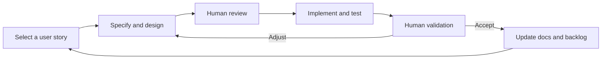

# AgileSpec - An Agile, Specification-Driven Workflow for AI-Native Software Development

## Motivation

Traditional software engineering processes took shape when people performed most
development tasks themselves, from translating requirements into designs to
writing and testing code. AI agents can now take on much of this work, changing
how developers move from an idea to a working feature. As implementation becomes
faster, developers need a clear way to communicate intent, review decisions, and
check that the result meets their expectations.

Traditional agile methods therefore need to adapt to a world where producing code
costs less time and effort, and AI can contribute throughout the development
process. Beyond implementation, AI can help refine requirements, explore design
decisions, and verify whether the software behaves as intended. This calls for
rethinking how developers organize the work and collaborate with AI across these
activities.

## AgileSpec

AgileSpec organizes development around small user stories and concise Markdown
documents. It draws inspiration from agile methods such as Scrum and XP through
small deliveries, feedback, and incremental refinement. However, it centers the
work on concise specifications that guide AI agents. People review the expected
behavior, technical design, and interface before implementation, then validate
the application after automated tests. Project documentation preserves global
context as the software evolves.



### Main Directories and Documents

AgileSpec uses two levels of specification: global project context and
story-specific decisions.

**`docs/`** contains project-wide decisions and the current state of the software.

- **`backlog.md`**: user stories, priorities, and completion status.
- **`tech-stack.md`**: technologies, dependencies, and environment choices.
- **`architecture.md`**: application structure and module responsibilities.
- **`database.md`**: implemented database schema and persistence decisions.
- **`ui.md`**: shared interface conventions.

Developers can write these documents manually or ask an AI agent to draft them
with human guidance and review. In either case, developers remain responsible
for the decisions they record.

**`work/`** contains development artifacts. To use AgileSpec, developers should
create a directory for each user story as development progresses, such as
`story1/`, `story2/`, and so on.

Each `work/storyN/` directory should contain three documents describing the story's
expected behavior, implementation, and interface. Developers can write them
manually or create them with AI assistance, using human guidance and review to
refine and approve their contents before implementation.

- **`spec.md`**: the user story and acceptance criteria, split into Normal Flow
  and Edge Cases.
- **`design.md`**: implementation approach and data changes.
- **`ui.md`**: screen layouts, components, and button labels.

An optional `setup/` directory holds **`tasks.md`**, a checklist for preparing
the development environment.

Once the three documents have been created and reviewed, the story can be
implemented using a prompt like the following. Replace `N` with the story number.

```text
Implement story N using the approved files in work/storyN/:
spec.md, design.md, and ui.md.

Read docs/ for project context. Preserve existing functionality
and ask if requirements conflict or important decisions are missing.

Add and run tests for Normal Flow and Edge Cases.
Report changes, test results, and how to validate the app.

After my validation, update affected docs/ files and mark the story
complete in the backlog.
```

### Workflow

1. **Select a story.** Choose a story from `docs/backlog.md`, review the global
   project context, and create its directory in `work/`.
2. **Specify the behavior.** Write `spec.md`, manually or with AI assistance.
   Review the Normal Flow and Edge Cases until they express what you want to build.
3. **Prepare the design and UI.** Write or ask the AI to draft `design.md` and
   `ui.md`. Review the approach and resolve open decisions before approving implementation.
4. **Request implementation.** Give the AI the approved documents and a prompt
   like the example above. Ask it to implement the story, add and run tests, and
   report the results.
5. **Validate the result.** Review the changes and test results, then try the
   application yourself. Request adjustments and update the affected specifications
   when your requirements or design decisions change.
6. **Close the story.** Once you accept the result, ask the AI to update affected
   documents in `docs/` and mark the story complete in the backlog. Review those
   updates before moving to the next story.

Keep documents short and avoid repeating information across files. Tell the AI
explicitly when you approve implementation or accept the result.

## Example: PodLite

PodLite is a small podcast player project built with Python, Streamlit, and SQLite.
The first two stories let listeners subscribe using RSS URLs and browse episodes.
Audio playback and other features remain in the backlog.

### `docs/`

- [backlog.md](docs/backlog.md): podcast features in priority order, with stories
  1 and 2 complete.
- [tech-stack.md](docs/tech-stack.md): Python, Streamlit, SQLite, standard-library
  feed processing, and pytest.
- [architecture.md](docs/architecture.md): UI, service, feed, and storage modules;
  separate podcast and episode views.
- [database.md](docs/database.md): the `podcasts` table, its columns and constraints;
  subscriptions persist in SQLite while episodes stay in session memory.
- [ui.md](docs/ui.md): native Streamlit components, English labels, cover-and-text
  cards, and simple navigation.

### `work/`

[setup/tasks.md](work/setup/tasks.md) records environment preparation and its checks.

#### `work/story1/` — Add a Podcast

- [spec.md](work/story1/spec.md): subscribe by RSS URL, persist subscriptions,
  prevent duplicates, and handle failures or missing metadata.
- [design.md](work/story1/design.md): URL validation, RSS parsing, and SQLite
  storage of podcast metadata.
- [ui.md](work/story1/ui.md): the subscription form and podcast cards with cover,
  title, and description.


#### `work/story2/` — Browse Episodes

- [spec.md](work/story2/spec.md): browse episodes newest first, reveal 10 at a time,
  return to subscriptions, and handle missing data or feed failures.
- [design.md](work/story2/design.md): session-based navigation, feed retrieval,
  date normalization, and episode metadata kept in memory.
- [ui.md](work/story2/ui.md): podcast and episode pages with **See Episodes**,
  **Back to Podcasts**, and **Load more** buttons.


