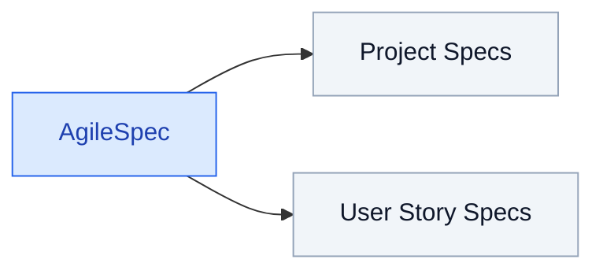
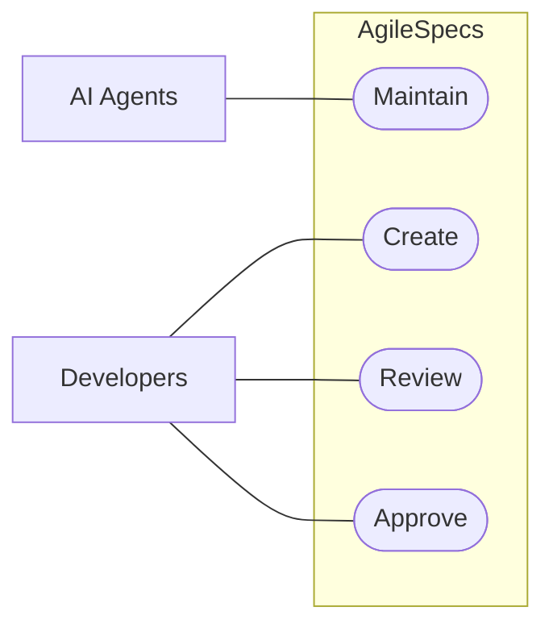
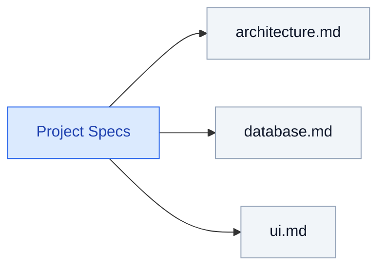
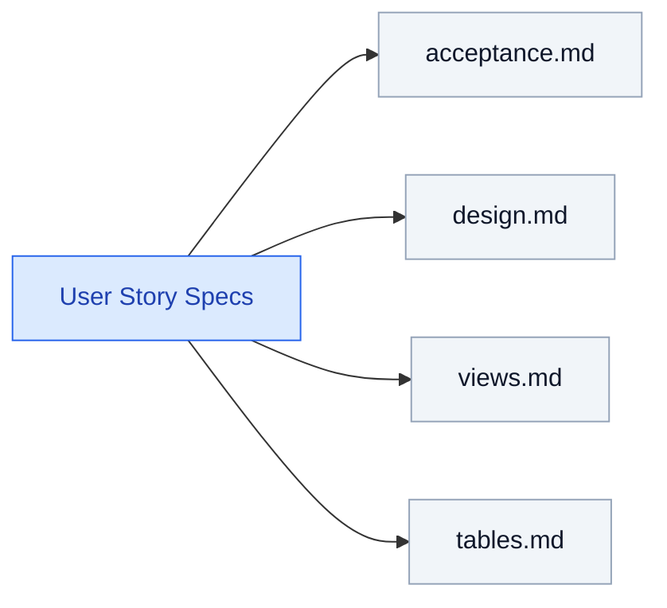
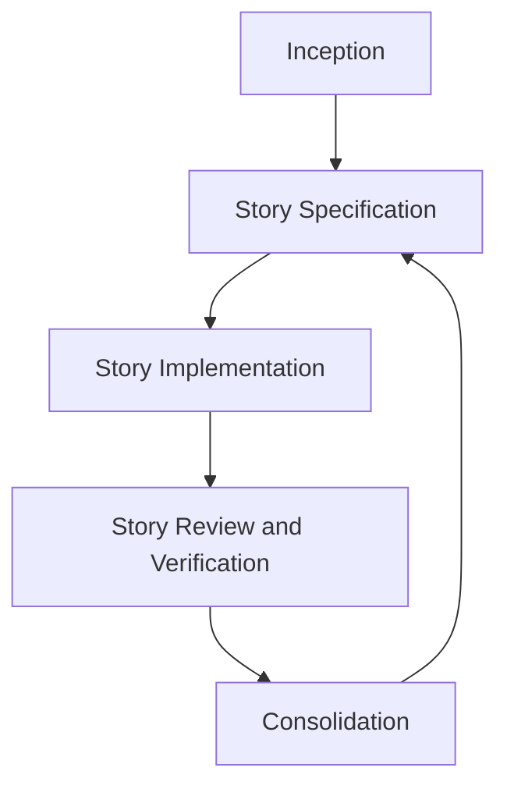
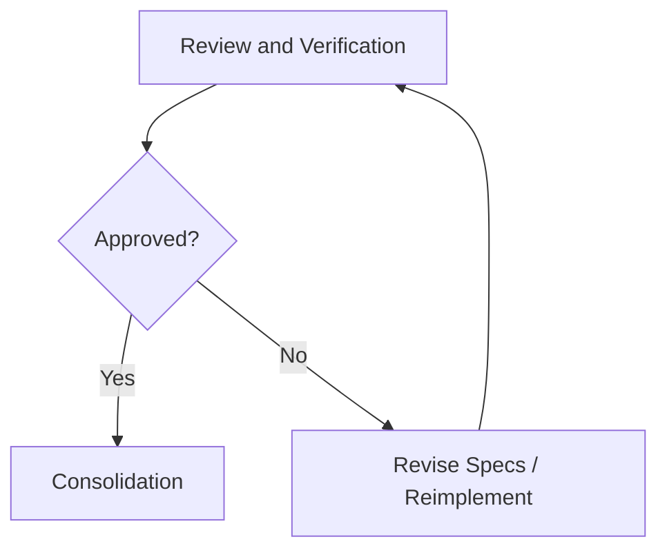
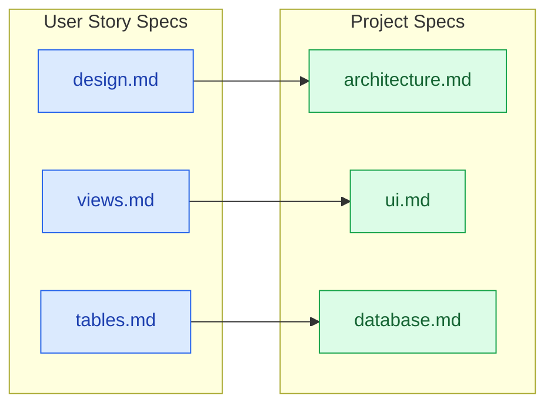
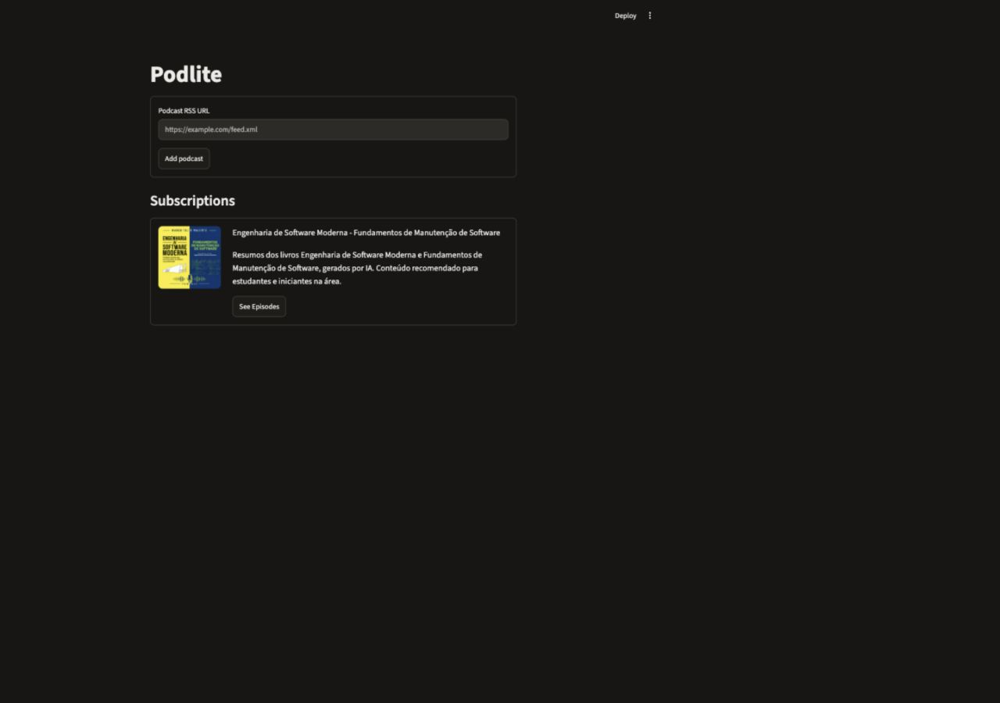

# AgileSpec — An Agile Workflow for AI-Native Development

## Motivation

Agile methods emerged when developers performed most software
development tasks themselves, from requirements and design to coding and
testing. Today, AI agents can take on much of this work, significantly
accelerating implementation.

This shift calls for new workflows that help developers define
lightweight specifications, guide AI coding agents during
implementation, and verify that the resulting software meets its
requirements while remaining consistent with project-wide decisions.

To address this need, we propose **AgileSpec**, a workflow for
developing software with AI coding agents that emphasizes lightweight,
living specifications.

## AgileSpec

AgileSpec organizes specifications into two main levels:

- **Project Specs** describe the system as a whole. They guide
  developers and AI agents in maintaining the system's conceptual
  integrity, ensuring that development remains aligned with its
  requirements and architectural decisions.

- **User Story Specs** capture requirements and decisions specific to
  individual stories. They guide AI agents in implementing each story
  while ensuring consistency with the project's global specifications.



We recommend storing these specifications in a directory named
`AgileSpec/` at the root of the project.

```text
AgileSpec/
  project/
    architecture.md
    ui.md
    database.md
  stories/
    storyN/
      acceptance.md
      design.md
      views.md
      tables.md
```

AI agents can help maintain, and synchronize these documents with the
codebase. However, developers remain responsible for reviewing and
approving their content, ensuring that the documentation accurately
reflects the system and its intended evolution.



### Project Specs

AgileSpec starts with a set of documents that provide a shared
understanding of the project. These documents serve as global project
documentation, guiding development decisions and providing context for
AI coding agents. They should remain accessible and up to date
throughout development.

At this level, we recommend three Markdown files stored in the
`AgileSpec/project/` directory:

- **`architecture.md`**: A high-level description of the system's
  architecture, including its main modules, their responsibilities, and
  architectural constraints. For example, UI components must access the
  database through a service layer rather than directly. This document
  should also describe the project's main technology choices, including
  programming languages, frameworks, and databases, preferably in a
  dedicated section.

- **`database.md`**: Describes the database schema, including tables,
  their columns and data types, primary and foreign keys, relationships
  between tables, and integrity constraints.

- **`ui.md`**: Describes the overall user interface structure,
  navigation, and shared design conventions. For example, it may specify
  that the application uses a sidebar for navigation, consistent button
  labels, and a common layout for displaying items.



Although these documents provide project-wide guidance, **they do not
need to be complete before implementation begins**. Requiring detailed
specifications upfront would contradict agile principles and risk
introducing Big Design Up Front (BDUF), an approach in which detailed
design decisions are made before development starts.

Instead, AgileSpec treats project documentation as a set of **living
documents** that evolve alongside the software. They are progressively
refined and extended as user stories are implemented.

### User Story Specs

As in traditional agile methods, AgileSpec organizes development around
individual user stories. A Product Owner or Product Manager selects a
story from the backlog and assigns it to a developer for implementation.

The developer then creates a directory for the story under
`AgileSpec/stories/`, using the story's identifier as its name (e.g.,
`story1/`, `story2/`, and so on).

Next, the developer prepares up to four Markdown files to guide the
story's implementation:

- **`acceptance.md`**: Defines the story's acceptance criteria,
  organized into **Normal Case** and **Edge Cases**. The former
  describes expected behavior under typical conditions, while the latter
  covers exceptional situations, invalid inputs, and boundary
  conditions.

- **`design.md`**: Describes story-specific implementation decisions,
  including classes, functions, modules, algorithms, and data
  structures.

- **`views.md`**: Describes story-specific screens, layouts, UI
  components, navigation, and interactions. This file is optional when
  the story does not involve UI changes.

- **`tables.md`**: Describes story-specific database changes, including
  tables, columns, relationships, and constraints. This file is optional
  when the story does not involve database changes.



As with project-level documentation, these files can be drafted with the
assistance of AI agents. However, they must be reviewed and approved by
the developer responsible for implementing the story.

## AgilSpec Workflow

AgileSpec follows an iterative workflow consisting of five main
activities:

1. Inception
2. Story Specification
3. Story Implementation
4. Story Review and Verification
5. Consolidation

The first activity establishes the project's initial context. The
remaining activities are repeated for each user story, allowing the
system and its specifications to evolve incrementally.



### 1. Inception

AgileSpec begins with an inception phase that establishes the project's
scope and initial technical direction. During this phase, developers
create project-level specifications in `AgileSpec/project/`, defining
key architectural, database, and UI decisions.

### 2. Story Specification

For each selected user story, the developer creates the corresponding
directory under `AgileSpec/stories/` and prepares `acceptance.md` and
`design.md`. The developer also creates `views.md` for UI changes and
`tables.md` for database changes.

The goal is to provide enough detail for an AI coding agent to implement
the story without introducing unnecessary documentation.

### 3. Story Implementation

Once the story-level specifications are approved, an AI coding agent
implements the story using both the story-specific documents and the
global project context.

The developer can initiate implementation with a prompt such as:

```text
Implement story N using the approved specifications in
AgileSpec/stories/storyN/:
- acceptance.md
- design.md
- views.md (if present)
- tables.md (if present)

Read AgileSpec/project/ for project-wide context and constraints.

Follow the approved design, views, and table changes where applicable.
Preserve existing functionality and avoid unrelated changes. If
requirements conflict or important decisions are missing, ask for
clarification before proceeding.

Implement and run automated tests covering the Normal Case and Edge
Cases defined in acceptance.md.

When finished, summarize:
- The changes made
- The tests executed and their results
- Any limitations or unresolved issues
- Instructions for manually validating the story

Do not update project-level documentation or mark the story as complete
yet.
```

### 4. Story Review and Verification

After implementation, the developer reviews the changes and verifies
that the story satisfies its acceptance criteria.

Verification may involve inspecting the generated code, running
automated tests, and manually interacting with the application.
Particular attention should be given to the Normal Case and Edge Cases
documented in `acceptance.md`, as well as compliance with the approved
design and, where present, `views.md` and `tables.md`.

If problems are found, the developer provides feedback to the AI agent,
which revises the implementation. This cycle continues until the story
is approved. If implementation reveals missing or incorrect
specifications, the corresponding story-level documents should also be
updated.



### 5. Consolidation

Once the story has been implemented and approved, its relevant design
decisions and changes must be incorporated into the project-level
documentation.

This activity, called **Consolidation**, ensures that the global
specifications remain consistent with the implemented system, using the
correspondence between the two levels:

- **`design.md` to `architecture.md`**: Incorporate relevant
  architectural decisions.
- **`views.md` to `ui.md`**: Incorporate relevant global UI structure
  and conventions.
- **`tables.md` to `database.md`**: Incorporate database schema changes.



Consolidation can be performed with the assistance of an AI agent using
a prompt such as:

```text
Consolidate the completed implementation of story N into the
project-level documentation.

Read:
- AgileSpec/stories/storyN/
- AgileSpec/project/
- The relevant implemented source code

Use the following correspondence, skipping absent optional files:
- design.md to architecture.md: incorporate architectural decisions
- views.md to ui.md: incorporate global UI structure and conventions
- tables.md to database.md: incorporate schema changes

Incorporate relevant decisions and changes, keeping the documentation
concise, accurate, and consistent with the implemented code.

Preserve the distinction between project-wide documentation and
story-specific implementation details. Do not copy entire story
specifications into project-level documents.

Do not modify the source code or story-level specifications.

Summarize the documentation changes for developer review.
```

The developer reviews and approves the resulting documentation changes.

Consolidation completes the development cycle for a story. The next
story can then be selected from the backlog, using the updated
project-level documentation as context.


## Frequently Asked Questions

**1. Does AgileSpec define events such as sprints, reviews, and
retrospectives?**

AgileSpec focuses on lightweight specifications and a workflow for agile
development with AI coding agents. Events such as sprints, reviews, and
retrospectives remain relevant but fall outside its scope. Teams are
free to continue using these practices alongside AgileSpec.

**2. What about roles (e.g., Product Owner and Scrum Master) and
artifacts (e.g., product backlog)?**

Similarly, AgileSpec does not prescribe specific roles or a complete set
of agile artifacts. Teams can retain their existing roles and practices.
Some artifacts, such as the product backlog, are already part of
AgileSpec.

**3. Can I add specifications beyond those proposed by AgileSpec?**

Absolutely. In keeping with agile principles, AgileSpec is flexible by
design. Teams can extend, adapt, or simplify its specifications and
workflow to suit their project's needs.

## Example: PodLite

PodLite is a small podcast player built with Python, Streamlit, and
SQLite. It illustrates how AgileSpec can be applied to a simple
application.

The first two stories allow users to subscribe to podcasts using RSS
URLs and browse their episodes. Audio playback and other features remain
in the backlog.

### `AgileSpec/project/`

The project-level documentation consists of four files:

- **[backlog.md](AgileSpec/project/backlog.md)**: Lists podcast features
  in priority order, with stories 1 and 2 marked as complete.
- **[architecture.md](AgileSpec/project/architecture.md)**: Describes
  the UI, service, feed, and storage modules and their responsibilities.
  Its Tech Stack section records Python, Streamlit, SQLite,
  standard-library feed processing, and pytest.
- **[database.md](AgileSpec/project/database.md)**: Documents the
  `podcasts` table and its constraints. Subscriptions persist in SQLite,
  while episode data remains in session memory.
- **[ui.md](AgileSpec/project/ui.md)**: Establishes global UI structure
  and conventions, including separate podcast and episode views, English
  labels, and cover-and-text cards.

### `AgileSpec/stories/`

Each implemented story has its own directory containing the
specifications used to guide the coding agent.

#### `story1/` — Add a Podcast

The first story allows users to subscribe to podcasts by entering an RSS
feed URL.

- **[spec.md](AgileSpec/stories/story1/spec.md)**: Defines subscription
  by RSS URL, persistent storage, duplicate prevention, and handling of
  invalid feeds or missing metadata.
- **[design.md](AgileSpec/stories/story1/design.md)**: Specifies URL
  validation, RSS parsing, and subscription storage operations.
- **[views.md](AgileSpec/stories/story1/views.md)**: Describes the
  subscription form and cards displaying covers, titles, and
  descriptions.
- **[tables.md](AgileSpec/stories/story1/tables.md)**: Specifies the
  `podcasts` table, its columns and constraints, and compatible schema
  updates.



#### `story2/` — Browse Episodes

The second story allows users to browse episodes from their subscribed
podcasts.

- **[spec.md](AgileSpec/stories/story2/spec.md)**: Defines episode
  browsing newest first, revealing 10 episodes at a time, returning to
  subscriptions, and handling missing data or feed failures.
- **[design.md](AgileSpec/stories/story2/design.md)**: Specifies
  session-based navigation, feed retrieval, date normalization, and
  in-memory storage of episode metadata.
- **[views.md](AgileSpec/stories/story2/views.md)**: Describes the
  podcast and episode views, including **See Episodes**, **Back to
  Podcasts**, and **Load more** buttons.

Story 2 does not need `tables.md`: it keeps episodes in session memory
and introduces no database changes.


Together, these two stories illustrate the incremental nature of
AgileSpec. Each story is specified, implemented, verified, and
consolidated before development proceeds. As a result, both the
application and its project-level documentation evolve incrementally,
providing an up-to-date foundation for subsequent stories.
