**Note:** AgileSpec is currently a preliminary proposal and is
subject to further refinement and evolution.

<p align="center">
  
</p>

# An Agile Workflow for AI-Assisted Software Development

[Frequently Asked Questions](faq.md) |
[PodLite Example](examples/podlite/README.md)
## Table of Contents

- [Motivation](#motivation)
- [Specifications](#specifications)
- [Project Specs](#project-specs)
- [User Story Specs](#user-story-specs)
- [Folder Structure](#folder-structure)
- [Workflow](#workflow)
- [Summary and Key Principles](#summary-and-key-principles)
- [Example: PodLite](#example-podlite)
- [Frequently Asked Questions](#frequently-asked-questions)
- [License](#license)
## Motivation

*Lightweight specifications over opaque implementations.*

Agile methods emerged when developers performed most software
development tasks themselves, from requirements and design to coding and
testing. Today, AI agents can take on much of this work, significantly
accelerating implementation.
This shift calls for new workflows that help developers define
lightweight specifications, guide AI coding agents during
implementation, and verify that the resulting software meets its
requirements while remaining consistent with project-wide decisions.

To address this need, we propose **AgileSpec**, a workflow for
developing software with AI coding agents that emphasizes lightweight,
living specifications.
## Specifications

AgileSpec organizes specifications into two main levels:

- **Project Specs** describe the system as a whole. They guide
  developers and AI agents in maintaining the system's conceptual
  integrity, ensuring that development remains aligned with its
  requirements and architectural decisions.

- **User Story Specs** capture requirements and decisions specific to
  individual stories. They guide AI agents in implementing each story
  while ensuring consistency with the project specs.

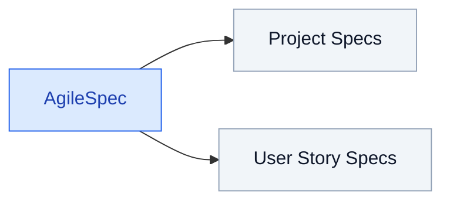

The two specification levels are connected through a **Specification
Alignment Loop**: project specs guide the creation and implementation of
user story specs, while decisions made during story implementation are
consolidated back into the project specs. This continuous feedback loop
keeps both levels aligned as the system evolves.

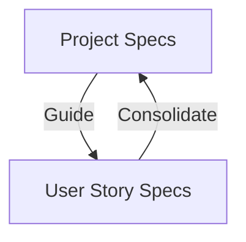

AI agents can help maintain, and synchronize these documents with the
codebase. However, developers remain responsible for reviewing and
approving their content, ensuring that the documentation accurately
reflects the system and its intended evolution.

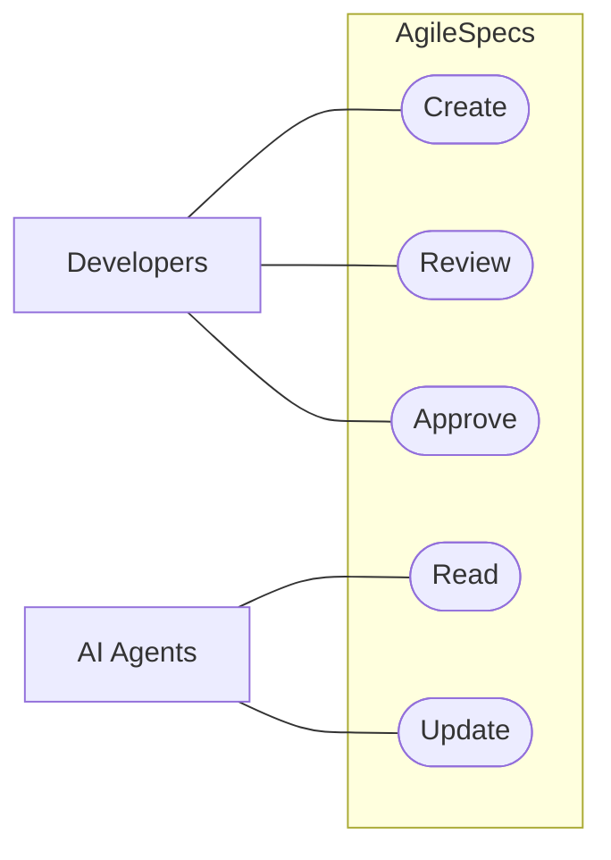

## Project Specs

Using AgileSpec begins with creating a set of documents that provide a
shared understanding of the project. These documents serve as global
project documentation, guiding development decisions and providing
context for AI coding agents. They should remain accessible and up to
date throughout development.

At the Project Specs level, there are five main Markdown documents:
- **`backlog.md`**: Lists user stories in priority order, with a brief
  description and status for each. This gives AI coding agents a global
  view of the system's features and main requirements.

- **`definition-of-done.md`**: Defines shared completion criteria for
  all stories, such as passing tests, human validation, and consolidated
  project specs.
- **`architecture.md`**: A high-level description of the system's
  architecture, including its main modules, their responsibilities, and
  architectural constraints. For example, services must access the database
  through repositories rather than directly. This document
  should also describe the project's main technology choices, including
  programming languages, frameworks, and databases, preferably in a
  dedicated section.
- **`database.md`**: Describes the database schema, including tables,
  their columns and data types, primary and foreign keys, relationships
  between tables, and integrity constraints.

- **`ui.md`**: Describes the overall user interface structure,
  navigation, and shared design conventions. For example, it may
  define colors, typography, reusable components, and common layouts.

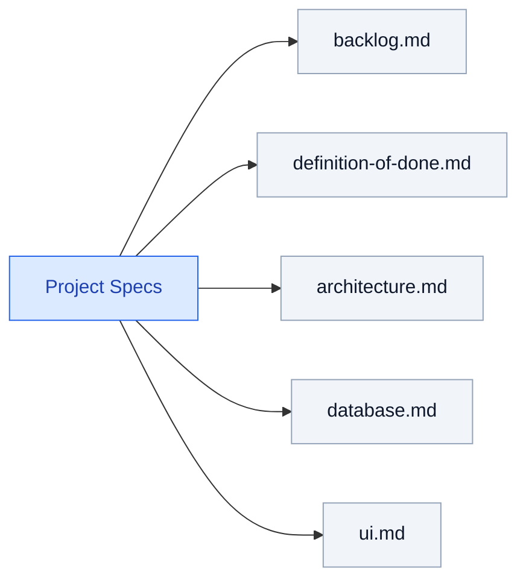

Although these documents provide project-wide guidance, **they do not
need to be complete before implementation begins**. Requiring detailed
specifications upfront would contradict agile principles and risk
introducing Big Design Up Front (BDUF), an approach in which detailed
design decisions are made before development starts.
Instead, AgileSpec treats project documentation as a set of **living
documents** that evolve alongside the software. They are progressively
refined and extended as user stories are implemented.

## User Story Specs

As in traditional agile methods, AgileSpec organizes development around
individual user stories. A Product Owner or Product Manager selects a
story from `backlog.md` and assigns it to a developer for
implementation.

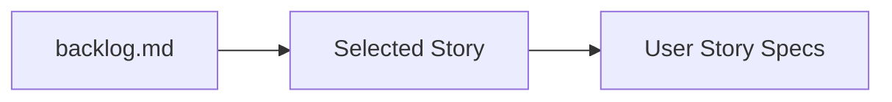

Next, the developer prepares four Markdown files, collectively referred
to as user story specifications, to guide the story's implementation:

- **`acceptance.md`**: Defines the story's acceptance criteria,
  organized into **Normal Case** and **Edge Cases**. The former
  describes expected behavior under typical conditions, while the latter
  covers exceptional situations, invalid inputs, and boundary
  conditions.

- **`design.md`**: Describes story-specific implementation decisions,
such as classes and functions to be created, API endpoints to be
implemented, libraries to be used, and interactions with external services.

- **`views.md`**: Describes story-specific screens, layouts, UI
  components, navigation, and interactions. This file is optional when
  the story does not involve UI changes.

- **`tables.md`**: Describes story-specific database changes, including
  tables, columns, relationships, and constraints. This file is optional
  when the story does not involve database changes.


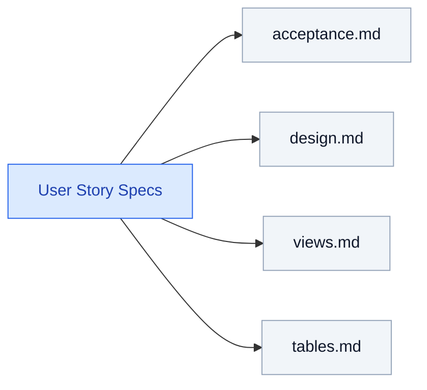

As with project specs, these files can be drafted with the
assistance of AI agents. However, they must be reviewed and approved by
the developer responsible for implementing the story.

## Folder Structure

AgileSpec specifications should be stored alongside the source
code, in an `AgileSpec/` directory at the root of the project.
This makes them easier for agents to access and allows them to
be versioned together with the code.

```text
my-project/
  AgileSpec/
    project/
      backlog.md
      definition-of-done.md
      architecture.md
      ui.md
      database.md
    stories/
      storyN/
        acceptance.md
        design.md
        views.md
        tables.md
  src/
  tests/
  other-folders/
```

Even after a user story has been implemented, its directory and
associated files should remain in the project repository. They serve as
documentation for the story, support **traceability between requirements,
design decisions, and the source code**, and can be particularly useful
during future maintenance, such as fixing bugs or adapting to changes
in business rules.

## Workflow

AgileSpec follows an iterative workflow consisting of five main
activities:

- Inception
- Story-Level Activities
  - Specification
  - Implementation
  - Review and Verification
- Consolidation

The first activity establishes the project's initial context. The
next three activities are repeated for each user story, allowing
the system and its specifications to evolve incrementally. The last
activity consolidates the decisions made during story implementation
into the project's global specifications, keeping them consistent
with the evolving implementation.

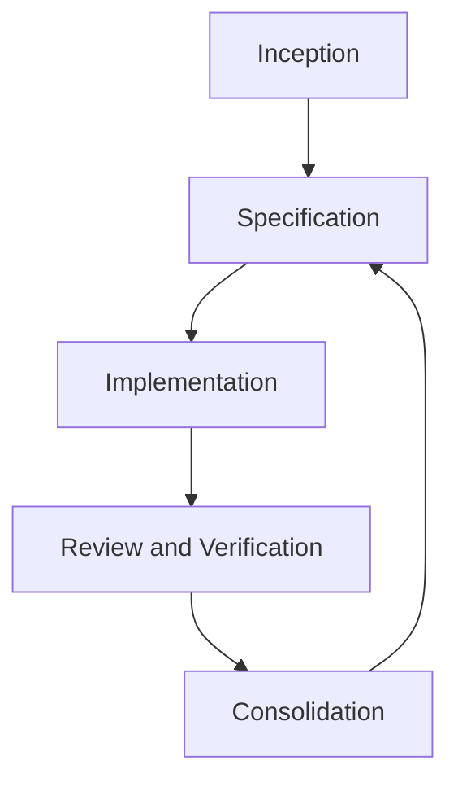

### Inception

AgileSpec begins with an inception phase that establishes the project's
scope and initial technical direction. During this phase, developers
create an initial `backlog.md` with prioritized user stories and define
key architectural, database, and UI decisions in the other project
specs. They also create a `definition-of-done.md` to establish shared
completion criteria.

### Specification

The developer selects a story from `backlog.md` and prepares
`acceptance.md` and `design.md`, adding `views.md` and `tables.md` when
UI or database changes are involved.

The goal is to provide enough detail for an AI coding agent to implement
the story without introducing unnecessary documentation.

For concrete examples of user story specifications, see how AgileSpec is used to implement a simple podcast player,
called [PodLite](examples/podlite/README.md)

### Implementation

Once the specs are approved, an AI coding agent implements the story
using both the project and story specs.

The developer can initiate implementation with a prompt such as:

```text
Implement story N using the approved specifications in
AgileSpec/stories/storyN/:
- acceptance.md
- design.md
- views.md (if present)
- tables.md (if present)

Read AgileSpec/project/ for project-wide context and constraints,
including the selected story in backlog.md and the shared criteria in
definition-of-done.md.

Follow the approved design, views, and table changes where applicable.
Preserve existing functionality and avoid unrelated changes. If
requirements conflict or important decisions are missing, ask for
clarification before proceeding.

Implement and run automated tests covering the Normal Case and Edge
Cases defined in acceptance.md.

When finished, summarize:
- The changes made
- The tests executed and their results
- Any limitations or unresolved issues
- Instructions for manually validating the story
- Any Definition of Done criteria still pending

Do not update project-level documentation or mark the story complete.
```

#### Automation

The implementation prompt is available in
[`prompts/implementation.md`](prompts/implementation.md). To use it:

```text
Follow prompts/implementation.md to implement story [n] in
[project directory].
```

You can also use the corresponding
[skill](.agents/skills/agilespec-implementation/SKILL.md), which reads the
same prompt to keep the instructions in one place. In Codex:

```text
$agilespec-implementation Implement story [n] in [project directory].
```

### Review and Verification

After implementation, the developer reviews the changes and verifies
that the story meets the acceptance criteria defined in
`definition-of-done.md`, including passing tests and human validation.

Verification may involve inspecting the generated code, running
automated tests, and manually interacting with the application.
Particular attention should be given to the Normal Case and Edge Cases
documented in `acceptance.md`, as well as compliance with the approved
design and, where present, `views.md` and `tables.md`.

If problems are found, the developer provides feedback to the AI agent,
which revises the implementation. This cycle continues until the story
is approved. If implementation reveals missing or incorrect
specifications, the corresponding story specs should also be
updated.

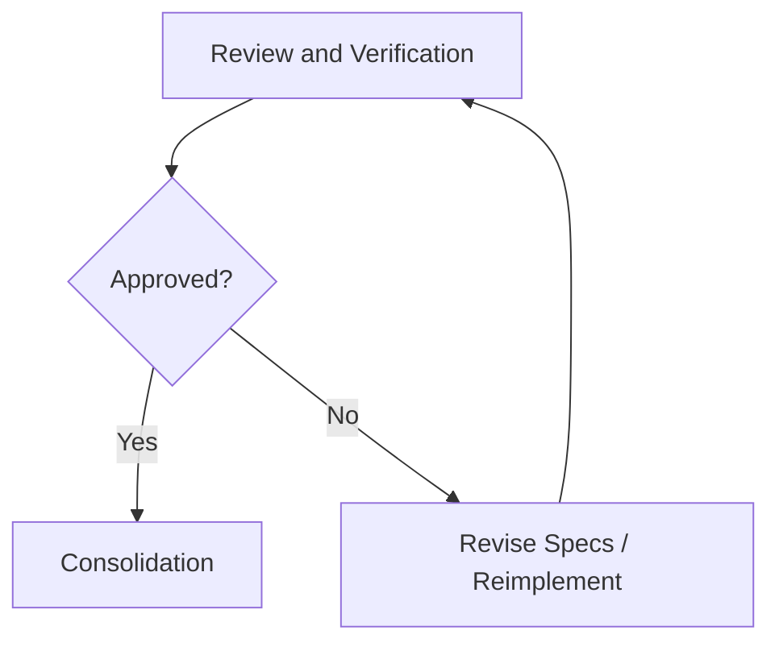

### Consolidation

Project specs evolve incrementally as stories are developed. After each story, **Consolidation** incorporates relevant decisions into the project specs, ensuring that subsequent stories build on an up-to-date description of the system.

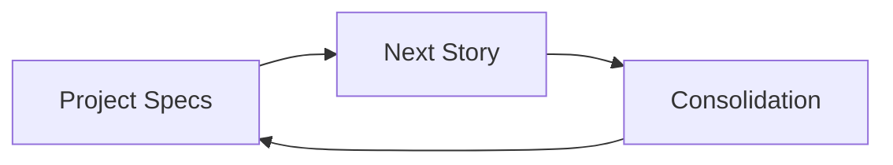

 Consolidation updates project specs based on their corresponding user story specs:

- **`acceptance.md` → `backlog.md`**: Update the story summary if needed and
  mark it as complete after approval.
- **`design.md` → `architecture.md`**: Incorporate relevant architectural decisions.
- **`views.md` → `ui.md`**: Incorporate relevant UI structure and conventions.
- **`tables.md` → `database.md`**: Incorporate database schema changes.

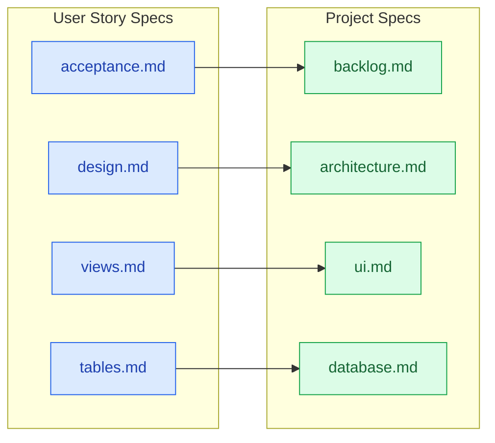

Consolidation can be performed with the assistance of an AI agent using
a prompt such as:

```text
Consolidate the implemented and validated story N in [project directory]
into its project-level documentation.

Read, relative to that directory:
- AgileSpec/stories/storyN/
- AgileSpec/project/
- The relevant implemented source code

Use the following correspondence, skipping absent optional files:
- acceptance.md to backlog.md: adjust the story summary if needed
- design.md to architecture.md: incorporate architectural decisions
- views.md to ui.md: incorporate global UI structure and conventions
- tables.md to database.md: incorporate schema changes

Incorporate relevant decisions and changes, keeping the documentation
concise, accurate, and consistent with the implemented code.

Preserve the distinction between project-wide documentation and
story-specific implementation details. Do not copy entire story
specifications into project-level documents.

Do not modify the source code or story-level specifications.
If the specifications and code disagree, report the discrepancy before
consolidating.

Summarize the documentation changes and any unmet Definition of Done
criteria for developer review. Leave the story unchecked in backlog.md
until the developer approves consolidation and all completion criteria
are met.
```

Consolidation completes the development cycle for a story. The next
story can then be selected from `backlog.md`, using the updated
project specs as context.

#### Automation

The consolidation prompt is available in
[`prompts/consolidation.md`](prompts/consolidation.md). To use it:

```text
Follow prompts/consolidation.md to consolidate story [n] in
[project directory].
```

You can also use the corresponding
[skill](.agents/skills/agilespec-consolidation/SKILL.md), which reads the
same prompt to keep the instructions in one place. In Codex:

```text
$agilespec-consolidation Consolidate story [n] in [project directory].
```

## Summary and Key Principles

In summary, AgileSpec follows a **spec-anchored approach**: specifications
are created before implementation, retained alongside the code, and
continuously evolved to support software maintenance and evolution.

Its distinguishing feature is the **Specification Alignment Loop**, which
ensures that project specs guide individual stories while story-level
decisions continuously refine and evolve project specs.

AgileSpec is also guided by the following principles and characteristics:

1. **Focus on Software Delivery**: Assumes that product discovery has
already produced a backlog of user stories ready for implementation.

2. **Adherence to Agile Principles**: Supports iterative and incremental
design and implementation, avoiding Big Design Up Front (BDUF).

3. **Compatibility with Agile Events**: Remains compatible with events
such as sprint planning, daily stand-ups, reviews, and retrospectives.

4. **Compatibility with Agile Roles**: Accommodates roles such as
Product Owners, Product Managers, and Scrum Masters.

5. **Specification-to-Code Traceability**: Preserves the specifications
behind AI-generated code, facilitating future maintenance and evolution.

6. **Preservation of Conceptual Integrity**: Uses project-level
specifications to maintain consistency in architecture, user interfaces,
and database design.

7. **Autonomy of AI Coding Agents**: Allows agents to plan and implement
solutions autonomously while adhering to project-level and story-level
specifications.

8. **Tool Independence**: Does not depend on specific tools, IDEs, or AI
coding agents, allowing teams to use their preferred development
environments.

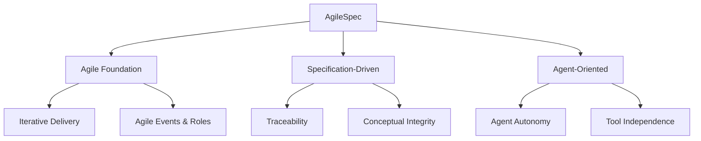

## Example: PodLite

See [PodLite](examples/podlite/README.md) for the podcast-player example
and its setup instructions.

<p align="center">
  
</p>

- [PodLite v0](examples/podlite/podlite-v0/README.md): inception.
- [PodLite v1](examples/podlite/podlite-v1/README.md): Story 1 (RSS
  subscriptions).
- [PodLite v1 Consolidated](examples/podlite/podlite-v1-consolidated/README.md):
  story 1 consolidated and approved.
- [PodLite v2](examples/podlite/podlite-v2/README.md): Story 2
  (episode browsing), consolidated and approved.

## Frequently Asked Questions

See the [FAQ](faq.md) for answers to common questions about AgileSpec.

## License

This project is licensed under the [MIT License](LICENSE).
