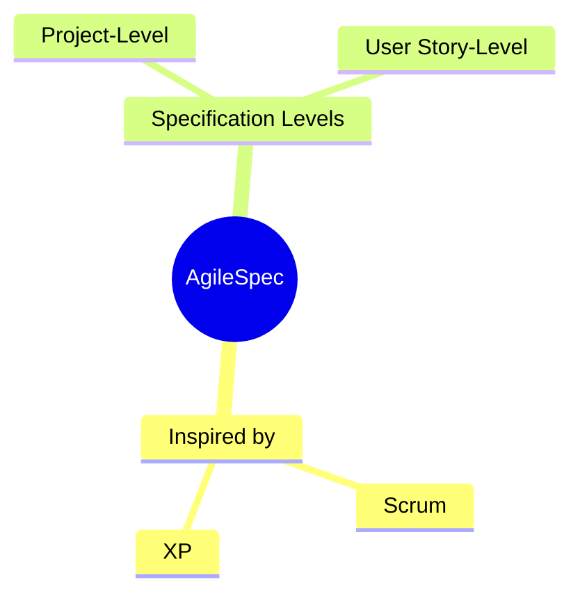
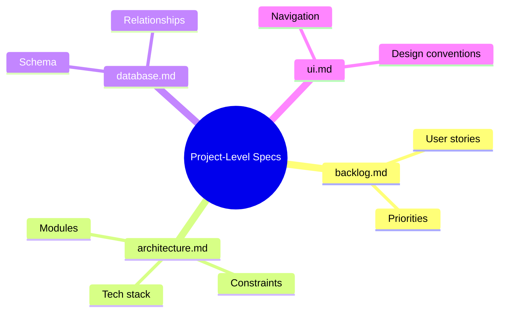
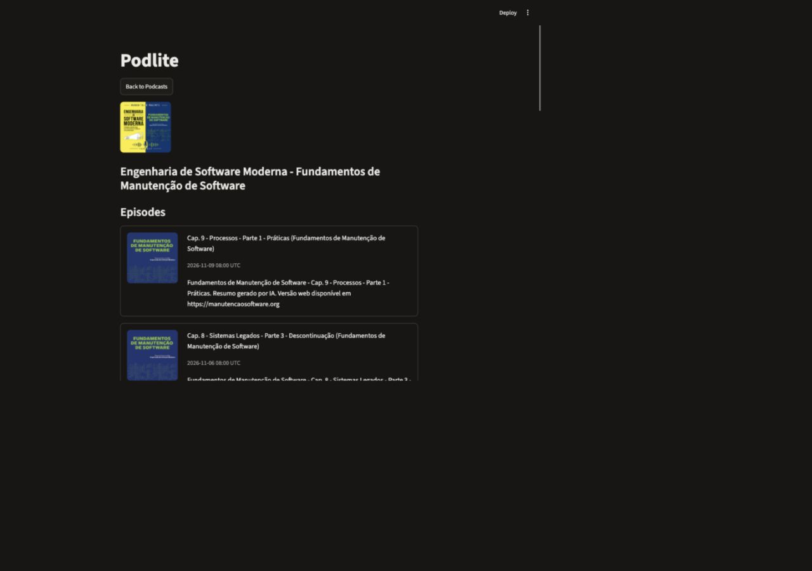

# AgileSpec — An Agile, Specification-Driven Workflow for AI-Native Software Development

## Motivation

Traditional agile methods emerged when developers performed most
software development tasks themselves, from requirements and design to
coding and testing. Today, AI agents can take on much of this work,
significantly accelerating implementation.

This shift calls for new workflows that help developers specify
requirements, guide AI coding agents, and verify that the resulting
software meets its specifications.

To address this need, we propose **AgileSpec**, a workflow for
developing software with AI coding agents that
emphasizes **lightweight, living specifications**.

## AgileSpec

AgileSpec draws inspiration from agile methods such as Scrum and XP. It
organizes specifications into two main levels: 
 **Project-Level Specifications**  e **User Story-level Specifications**.



We recommend storing these specifications in a directory named
`AgileSpec/` at the root of the project.

### Project-Level Specifications

AgileSpec starts with a set of documents that provide a shared
understanding of the project. These documents serve as global project
documentation, guiding development decisions and providing context for
AI coding agents. They should remain accessible and up to date
throughout development.

At this level, we recommend four Markdown files stored in the
`AgileSpec/project/` directory:

- **`backlog.md`**: The product backlog, containing a prioritized list
    of user stories, typically written in the format: "As a [role], I
    want [feature] so that [benefit]."

- **`architecture.md`**: A high-level description of the system's
    architecture, including its main modules, their responsibilities,
    and architectural constraints. For example, UI components must
    access the database through a service layer rather than directly.
    This document should also describe the project's main technology
    choices, including programming languages, frameworks, and
    databases, preferably in a dedicated **Tech Stack** section.

- **`database.md`**: Describes the database schema, including tables,
    their columns and data types, primary and foreign keys,
    relationships between tables, and integrity constraints.

- **`ui.md`**: Describes the overall user interface structure,
    navigation, and shared design conventions. For example, it may
    specify that the application uses a sidebar for navigation,
    consistent button labels, and a common layout for displaying
    items.



The backlog is a central artifact of agile development, capturing
requirements as user stories that can be prioritized and implemented
incrementally. The remaining documents provide the technical context
needed to implement these stories.

Although these documents provide project-wide guidance, **they do not
need to be complete before implementation begins**. Requiring detailed
specifications upfront would contradict agile principles and risk
introducing Big Design Up Front (BDUF), an approach in which detailed
design decisions are made before development starts.

Instead, AgileSpec treats project documentation as a set of **living
documents** that evolve alongside the software. They are progressively
refined and extended as user stories are implemented.

AI agents can help create, maintain, and synchronize these documents
with the codebase. However, developers remain responsible for reviewing
and approving their content, ensuring that the documentation accurately
reflects the system and its intended evolution.

mindmap
  root((AgilSpec Docs))
    AI Agents
      Create
      Maintain
    Developers
      Review
      Approve

### User Story-Level Specifications

As in traditional agile methods, AgileSpec organizes development around
individual user stories. A Product Owner or Product Manager selects a
story from `backlog.md` and assigns it to a developer for
implementation.

The developer then creates a directory for the story under
`AgileSpec/stories/`, using the story's identifier as its name
(e.g., `story1/`, `story2/`, and so on).

Next, the developer prepares three Markdown files to guide the story's
implementation:

- **`spec.md`**: Defines the story's functional requirements and
    acceptance criteria, organized into **Normal Case** and **Edge
    Cases**. The former describes expected behavior under typical
    conditions, while the latter covers exceptional situations, invalid
    inputs, and boundary conditions.

- **`design.md`**: Provides a low-level design describing how the story
    will be implemented. It may identify the classes, functions,
    modules, algorithms, and data structures to be created or modified,
    as well as any required database changes. Unlike `architecture.md`,
    which describes the overall system structure, this document focuses
    on implementation decisions for a specific story.

- **`ui.md`**: Describes the story's user interface requirements,
    including screen layouts, UI components, navigation, input fields,
    buttons, and labels. It may also specify user interactions,
    validation messages, and visual states. For stories without UI
    changes, this document can be omitted.


```mermaid
mindmap
  root((User Story Specs))
    spec.md
      Normal Case
      Edge Cases
    design.md
      Classes and Functions
      Algorithms
      Database Changes
    ui.md
      Layouts
      Components
      Interactions
````

As with project-level documentation, these files can be drafted with the
assistance of AI agents. However, they must be reviewed and approved by
the developer responsible for implementing the story.

## Workflow

AgileSpec follows an iterative workflow consisting of five main
activities:

**Project-Level Specification → User Story-Level Specification →
  Implementation → Review and Verification → Consolidation**

The first activity establishes the project's initial context. The
remaining activities are repeated for each user story, allowing the
system and its specifications to evolve incrementally.

```
flowchart TD
    A["Project-Level Specification"]
    B["User Story-Level Specification"]
    C["Implementation"]
    D["Review and Verification"]
    E["Consolidation"]

    A --> B
    B --> C
    C --> D
    D --> E
    E -->|Update| A
```

### 1. Project-Level Specification

Development begins by creating the initial project-level documents in
`AgileSpec/project/`. These documents establish the product backlog and
initial architectural, database, and UI decisions.

### 2. User Story-Level Specification

For each selected user story, the developer creates the corresponding
directory under `AgileSpec/stories/` and prepares its `spec.md`,
`design.md`, and, when applicable, `ui.md` files.

The goal is to provide enough detail for an AI coding agent to implement
the story without introducing unnecessary documentation. Before
implementation begins, the developer reviews and approves these
specifications.

### 3. Implementation

Once the story-level specifications are approved, an AI coding agent
implements the story using both the story-specific documents and the
global project context.

The developer can initiate implementation with a prompt such as:

```text Implement story N using the approved specifications in
AgileSpec/stories/storyN/:
- spec.md
- design.md
- ui.md (if present)

Read AgileSpec/project/ for project-wide context and constraints.

Follow the approved design, preserve existing functionality, and avoid
unrelated changes. If requirements conflict or important decisions are
missing, ask for clarification before proceeding.

Implement and run automated tests covering the Normal Case and Edge
Cases defined in spec.md.

When finished, summarize:
- The changes made
- The tests executed and their results
- Any limitations or unresolved issues
- Instructions for manually validating the story

Do not update project-level documentation or mark the story as complete
yet. ```

The agent implements the story, creates or updates relevant tests, and
reports the results. However, passing automated tests does not
automatically mean that the story has been accepted.

### 4. Review and Verification

After implementation, the developer reviews the changes and verifies
that the story satisfies its acceptance criteria.

Verification may involve inspecting the generated code, running
automated tests, and manually interacting with the application.
Particular attention should be given to the Normal Case and Edge Cases
documented in `spec.md`, as well as compliance with the approved design
and UI specifications.

If problems are found, the developer provides feedback to the AI agent,
which revises the implementation. This cycle continues until the story
is approved. If implementation reveals missing or incorrect
specifications, the corresponding story-level documents should also be
updated.

### 5. Consolidation

Once the story has been implemented and approved, its relevant design
decisions and changes must be incorporated into the project-level
documentation.

This activity, called **Consolidation**, ensures that the global
specifications remain consistent with the implemented system. For
example, new database tables should be reflected in `database.md`,
architectural changes in `architecture.md`, and new navigation patterns
or shared UI conventions in `ui.md`.

Consolidation can be performed with the assistance of an AI agent using
a prompt such as:

```text Consolidate the completed implementation of story N into the
project-level documentation.

Read:
- AgileSpec/stories/storyN/
- AgileSpec/project/
- The relevant implemented source code

Update the affected project-level Markdown files:
- architecture.md
- database.md
- ui.md

Incorporate relevant decisions and changes, keeping the documentation
concise, accurate, and consistent with the implemented code.

Preserve the distinction between project-wide documentation and
story-specific implementation details. Do not copy entire story
specifications into project-level documents.

Mark story N as complete in AgileSpec/project/backlog.md.

Do not modify the source code or story-level specifications.

Summarize the documentation changes for developer review. ```

The developer reviews and approves the resulting documentation changes.

Consolidation completes the development cycle for a story. The next
story can then be selected from the backlog, using the updated
project-level documentation as context.

## Example: PodLite

PodLite is a small podcast player built with Python, Streamlit, and
SQLite. It illustrates how AgileSpec can be applied to a simple
application.

The first two stories allow users to subscribe to podcasts using RSS
URLs and browse their episodes. Audio playback and other features
remain in the backlog.

### `AgileSpec/project/`

The project-level documentation consists of four files:

- **`backlog.md`**: Lists podcast features in priority order, with
    stories 1 and 2 marked as complete.
- **`architecture.md`**: Describes the UI, service, feed, and storage
    modules, including separate podcast and episode views. Its Tech
    Stack section specifies Python, Streamlit, SQLite, standard-library
    feed processing, and pytest.
- **`database.md`**: Defines the `podcasts` table, its columns, and
    constraints. Podcast subscriptions persist in SQLite, while episode
    data remains in session memory.
- **`ui.md`**: Establishes shared UI conventions, including native
    Streamlit components, English labels, cover-and-text cards, and
    simple navigation.

### `AgileSpec/stories/`

Each implemented story has its own directory containing the
specifications used to guide the coding agent.

#### `story1/` — Add a Podcast

The first story allows users to subscribe to podcasts by entering an RSS
feed URL.

- **`spec.md`**: Defines subscription by RSS URL, persistent storage,
    duplicate prevention, and handling of invalid feeds or missing
    metadata.
- **`design.md`**: Specifies URL validation, RSS parsing, and SQLite
    storage of podcast metadata.
- **`ui.md`**: Describes the subscription form and podcast cards
    displaying cover images, titles, and descriptions.


#### `story2/` — Browse Episodes

The second story allows users to browse episodes from their subscribed
podcasts.

- **`spec.md`**: Defines episode browsing in reverse chronological
    order, displaying 10 episodes at a time, returning to the podcast
    list, and handling missing data or feed failures.
- **`design.md`**: Specifies session-based navigation, feed retrieval,
    date normalization, and in-memory storage of episode metadata.
- **`ui.md`**: Describes the podcast and episode views, including
    the **See Episodes**, **Back to Podcasts**, and **Load More**
    buttons.



Together, these two stories illustrate the incremental nature of
AgileSpec. Each story is specified, implemented, verified, and
consolidated before development proceeds. As a result, both the
application and its project-level documentation evolve incrementally,
providing an up-to-date foundation for subsequent stories.
