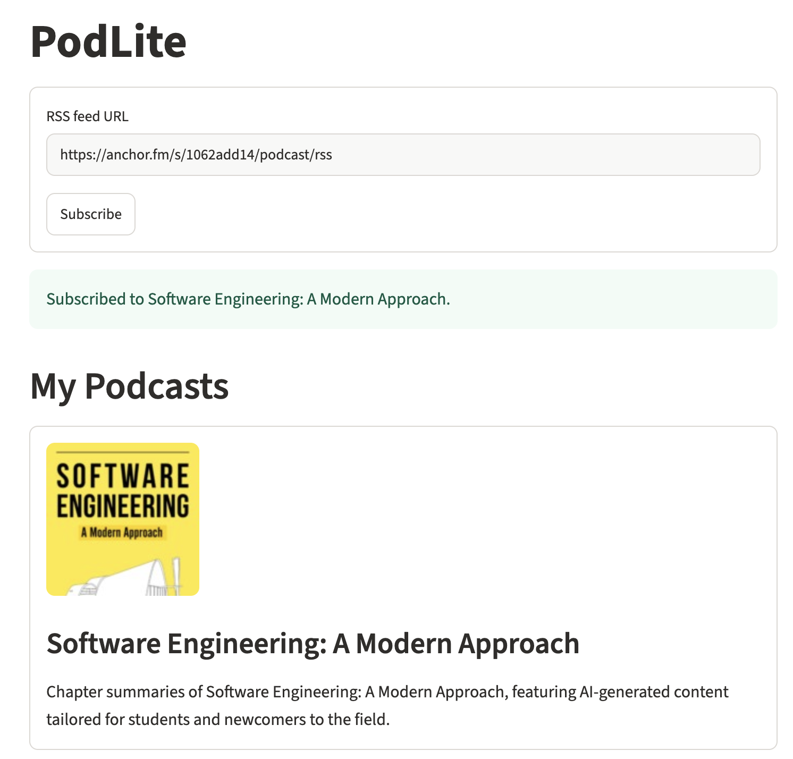
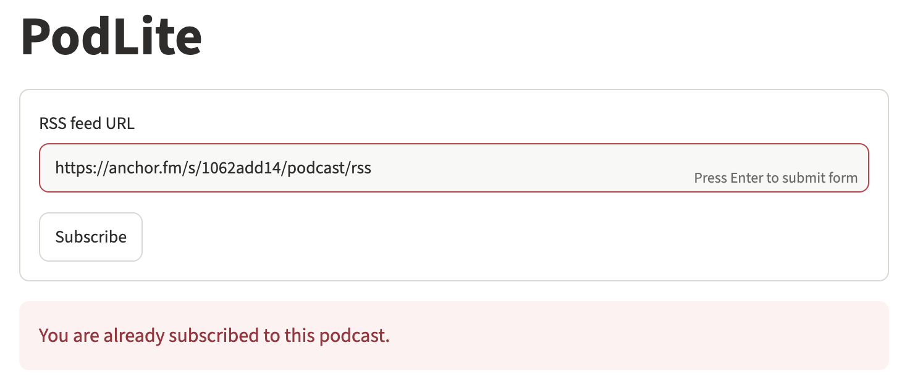
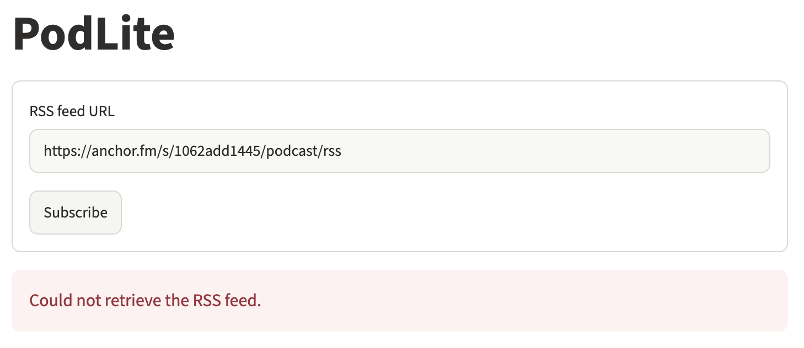

# PodLite v1

[PodLite](../README.md) | [AgileSpec](../../../README.md)

As a listener, I want to subscribe using an RSS URL and keep the podcast
in my list.

## Project Specs

Inherited from v0; this snapshot precedes consolidation:

- [backlog.md](AgileSpec/project/backlog.md)
- [architecture.md](AgileSpec/project/architecture.md)
- [ui.md](AgileSpec/project/ui.md)
- [database.md](AgileSpec/project/database.md)
- [definition-of-done.md](AgileSpec/project/definition-of-done.md)

## User Story Spec

- [acceptance.md](AgileSpec/stories/story1/acceptance.md)

  Defines subscribing by RSS URL, persistent subscriptions, and error
  handling through Normal Case and Edge Cases.

- [design.md](AgileSpec/stories/story1/design.md)

  Defines the modules for UI, services, feeds, and storage, with key
  decisions for fetching RSS and saving podcast metadata.

- [views.md](AgileSpec/stories/story1/views.md)

  Defines the subscription form, podcast list, and user feedback.

- [tables.md](AgileSpec/stories/story1/tables.md)

  Defines the `subscriptions` table, its columns, and constraints.

## Consolidation

This snapshot precedes consolidation. See
[the consolidated version](../podlite-v1-consolidated/README.md).

## Screenshot

### Normal Case

<p align="center">
  
</p>

### Edge Cases

<p align="center">
  
</p>

<p align="center">
  
</p>

## Run

From the repository root:

```bash
cd examples/podlite/podlite-v1
python3 -m venv .venv
source .venv/bin/activate
python -m pip install -r requirements-dev.txt
python -m streamlit run app.py
```

Run tests from the same directory with `python -m pytest`.
Subscriptions are stored locally in `data/podlite.db`.
