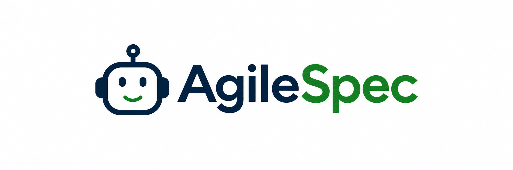

# PodLite v1

As a listener, I want to subscribe using an RSS URL and keep the podcast
in my list.

## Specifications

- [Project Specs](AgileSpec/project/): copied from v0.
  - [architecture.md](AgileSpec/project/architecture.md)
  - [ui.md](AgileSpec/project/ui.md)
  - [database.md](AgileSpec/project/database.md)
- User Story Specs:
  - [acceptance.md](AgileSpec/stories/story1/acceptance.md): expected
    behavior.
  - [design.md](AgileSpec/stories/story1/design.md): implementation
    decisions.
  - [views.md](AgileSpec/stories/story1/views.md): interface.
  - [tables.md](AgileSpec/stories/story1/tables.md): database changes.

## Screenshot

<p align="center">
  
</p>

## Run

From the repository root:

```bash
cd examples/podlite/podlite-v1
python3 -m venv .venv
source .venv/bin/activate
python -m pip install -r requirements-dev.txt
python -m streamlit run app.py
```

Run tests from the same directory with `python -m pytest`.
Subscriptions are stored locally in `data/podlite.db`.
