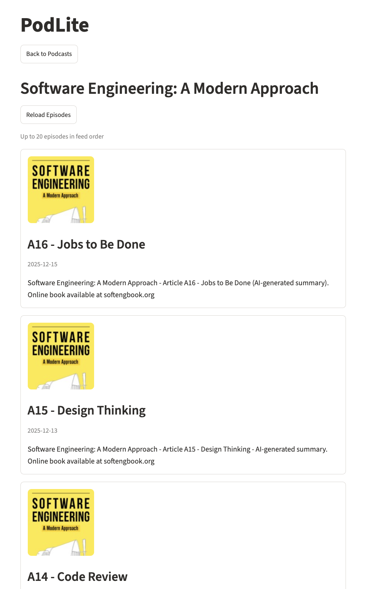

# PodLite v2

[PodLite](../README.md) | [AgileSpec](../../../README.md)

As a listener, I want to see a podcast's episodes.

## Project Specs

- [backlog.md](AgileSpec/project/backlog.md)
- [definition-of-done.md](AgileSpec/project/definition-of-done.md)
- [architecture.md](AgileSpec/project/architecture.md)
- [ui.md](AgileSpec/project/ui.md)
- [database.md](AgileSpec/project/database.md)

## User Story Spec

- [acceptance.md](AgileSpec/stories/story2/acceptance.md): expected behavior.
- [design.md](AgileSpec/stories/story2/design.md): implementation decisions.
- [views.md](AgileSpec/stories/story2/views.md): pages and navigation.

No `tables.md` is needed: episodes are read from RSS without database
changes.

## Consolidation

Changes relative to `podlite-v1-consolidated`: `-` removed, `+` added.

No new persistence conventions were needed; `database.md` is unchanged.

### architecture.md

Recorded page navigation and RSS episode retrieval without persistence.

```diff
--- previous/architecture.md
+++ v2/architecture.md
@@ -3,2 +3 @@
-PodLite will be a local web application for subscribing to podcasts,
-browsing episodes, and playing audio, without login.
+PodLite is a local podcast application without login.
@@ -16 +15 @@
-- `app.py`: Streamlit interface.
+- `app.py`: Streamlit pages and navigation using session state.
@@ -18 +17 @@
-- `podlite/feeds.py`: RSS and podcast metadata.
+- `podlite/feeds.py`: RSS, podcast metadata, and episode metadata.
@@ -21,0 +21,2 @@
+
+Episodes are read from RSS on demand and are not stored in SQLite.
```

### ui.md

Extended the card convention to episodes and recorded navigation back to
podcasts.

```diff
--- previous/ui.md
+++ v2/ui.md
@@ -7 +7,2 @@
-- Present podcasts as cards with cover, title, and plain-text description.
+- Present podcasts and episodes as cards, with consistent metadata order.
+- Provide navigation back to the podcast list from episode views.
```

## Screenshot

<p align="center">
  
</p>

## Run

From the repository root:

```bash
cd examples/podlite/podlite-v2
python3 -m venv .venv
source .venv/bin/activate
python -m pip install -r requirements-dev.txt
python -m streamlit run app.py
```

Run tests with `python -m pytest` from the same directory.
The database is local to this version at `data/podlite.db`.
