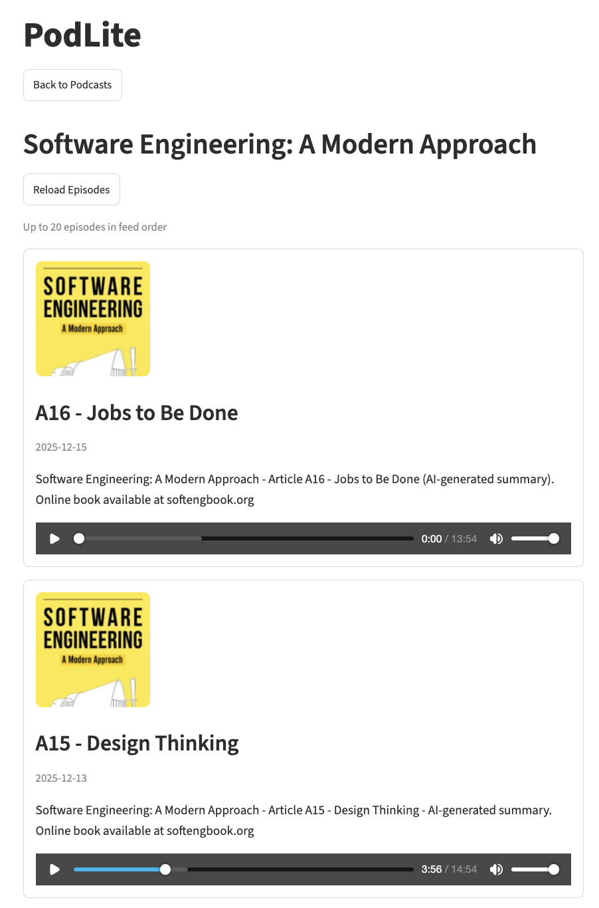

# PodLite v3

[PodLite](../README.md) | [AgileSpec](../../../README.md)

As a listener, I want to play, pause, and move through an episode.

## Project Specs

Story 3 consolidated and approved:

- [backlog.md](AgileSpec/project/backlog.md)
- [definition-of-done.md](AgileSpec/project/definition-of-done.md)
- [architecture.md](AgileSpec/project/architecture.md)
- [ui.md](AgileSpec/project/ui.md)
- [database.md](AgileSpec/project/database.md)

## Story 3 Specs

- [acceptance.md](AgileSpec/stories/story3/acceptance.md): expected behavior.
- [design.md](AgileSpec/stories/story3/design.md): implementation decisions.
- [views.md](AgileSpec/stories/story3/views.md): audio controls and layout.

No `tables.md` is needed: playback does not change the database.

## Screenshot

<p align="center">
  
</p>

## Run

From the repository root:

```bash
cd examples/podlite/podlite-v3
python3 -m venv .venv
source .venv/bin/activate
python -m pip install -r requirements-dev.txt
python -m streamlit run app.py
```

Run tests with `python -m pytest` from the same directory.
The database is local to this version at `data/podlite.db`.
