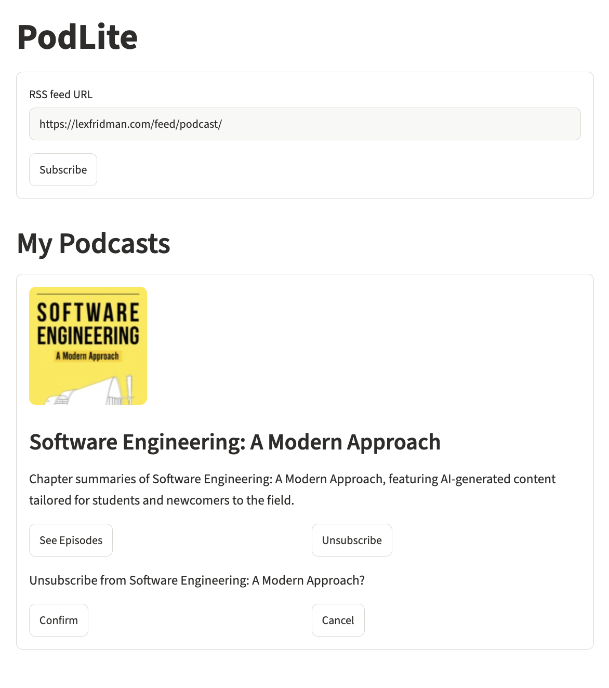

# PodLite v4

[PodLite](../README.md) | [AgileSpec](../../../README.md)

## Story 4: Unsubscribe from a Podcast

As a listener, I want to unsubscribe from a podcast.

## Project Specs

- [backlog.md](AgileSpec/project/backlog.md)
- [definition-of-done.md](AgileSpec/project/definition-of-done.md)
- [architecture.md](AgileSpec/project/architecture.md)
- [ui.md](AgileSpec/project/ui.md)
- [database.md](AgileSpec/project/database.md)

## Story 4 Specs

- [acceptance.md](AgileSpec/stories/story4/acceptance.md): expected behavior.
- [design.md](AgileSpec/stories/story4/design.md): implementation decisions.
- [views.md](AgileSpec/stories/story4/views.md): unsubscribe controls.

No `tables.md` is needed: unsubscribing uses the existing
subscriptions table.

## Screenshot

<p align="center">
  
</p>

## Run

From the repository root:

```bash
cd examples/podlite/podlite-v4
python3 -m venv .venv
source .venv/bin/activate
python -m pip install -r requirements-dev.txt
python -m streamlit run app.py --server.port 8504
```

Run tests with `python -m pytest` from the same directory.

## Consolidation

Consolidation was simple: `ui.md` records the unsubscribe confirmation,
and the story is marked complete in `backlog.md`. No changes were needed
in `architecture.md` or `database.md`, since the existing modules and
schema already support the feature.

Changes to `ui.md` relative to v3:

```diff
-- Home: subscription form and subscribed podcasts.
+- Home: subscription form and podcast cards with unsubscribe
+  confirmation.
```
